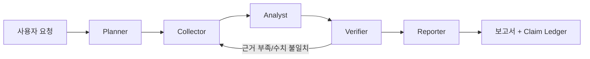

# 예선 기획서 초안 — 공시·재무 근거를 자동 검증하는 Peer Group 투자리서치 LangGraph Agent

> 표기: **[가정-확인필요]** = 검증되지 않은 주장(시장 규모, 경쟁 서비스 중복 등). 제출 전 근거를 확보하거나 삭제한다.
> 구조는 [`proposal-outline.md`](proposal-outline.md)의 10쪽 양식을 따른다.

## 1쪽 표지
- 팀명: (접수 시 등록한 팀명) / 팀장: (성명) / 팀원: (성명)

## 2쪽 Summary

| 항목 | 내용 |
|------|------|
| 서비스명 | (가칭) PeerCheck — 근거 검증형 Peer Group 리서치 Agent |
| 문제·사용자 | 투자 애널리스트가 비교 대상 기업의 공시·재무·뉴스를 수작업으로 모으고 비교하며, 수치·주장의 출처 확인에 많은 시간이 든다. 주요 사용자: 투자 리서치 담당자 |
| Agent 제안 | Planner → Collector → Analyst → Verifier → Reporter. 모든 주장을 출처에 연결(Claim Ledger), 재무 수치를 코드로 재계산, 뉴스-공시 충돌 표시, 근거 없는 문장은 "확인 불가" 처리 |
| 데이터·기술 | DART 공시·재무 API, 뉴스, LangGraph, LLM(교체 가능), 코드 기반 재계산 Tool |
| 기대효과 | 리서치 초안 작성 시간 단축 [가정-확인필요: 정량 목표는 파일럿 측정 후 확정], 출처 추적 가능한 보고서, 타 업무로 확장 |

## 3쪽 ① 문제 정의 (평가: 문제 정의 20)
- **업무**: 2~5개 비교 기업(Peer Group)의 사업·재무·리스크를 비교하는 투자 리서치.
- **현행 방식의 문제**
  1. 공시, 재무제표, 뉴스가 흩어져 있어 수집·정리에 시간 소요.
  2. 수치 전사·계산 과정의 오류 가능성, 출처 불명확한 문장이 보고서에 섞임.
  3. 뉴스 보도와 공시 내용이 다를 때 이를 체계적으로 확인하기 어려움.
  4. 일반 LLM 요약은 그럴듯하지만 근거가 없는 문장(환각)을 만들 수 있음.
- **사용자·시나리오**: 애널리스트가 "A, B, C사의 최근 수익성·재무 안정성 비교"를 요청 → 근거가 연결된 비교 보고서와 검증 요약을 수신.
- **필요성**: 투자 판단 자료는 신뢰성이 핵심이므로 "빠른 요약"보다 "검증 가능한 요약"이 필요.
- **[가정-확인필요]** 현업의 리서치 소요 시간·오류 빈도, 시장 규모, 유사 서비스(기존 리서치/요약 도구)와의 중복 여부 — 인터뷰·조사로 확인.

## 4쪽 ② 서비스 제안 및 차별성 (평가: 차별성 20)
- **개요**: 비교 요청을 받아 공시·재무 데이터를 수집·분석하고, 모든 주장을 검증한 뒤 보고서를 생성하는 Agent.
- **흐름**: 사용자 입력(기업 2~5개, 관점) → 계획 → 수집 → 비교 분석 → 검증 → 보고서(주장별 출처 하이라이트 + 검증 요약).
- **차별점**
  1. **Claim Ledger**: 보고서의 모든 주장을 출처(공시 접수번호, 계정과목, 기사 URL 등)에 연결.
  2. **코드 재계산**: 매출성장률·영업이익률·부채비율 등을 LLM이 아닌 코드로 재계산해 원문 수치와 대조.
  3. **충돌 탐지**: 뉴스 주장이 공시와 다르면 충돌로 표시.
  4. **확인 불가 처리**: 근거 없는 문장은 삭제하지 않고 "확인 불가"로 명시.
- **[가정-확인필요]** "기존 서비스에는 이 기능이 없다"는 주장은 경쟁 조사 후 확정.

## 5쪽 ③ Agent 역할 및 Workflow (평가: Agent 구성 25)

| 역할 | 목표 | 자율 판단·수행 |
|------|------|----------------|
| Planner | 요청을 분석해 대상 기업·비교 지표·수집 계획 수립 | 기업명 식별, 지표 선택, 필요한 Tool 결정 |
| Collector | DART 공시·재무 API와 뉴스 수집 | 누락 데이터 재조회, 실패 시 재시도 |
| Analyst | Peer 비교, 지표 계산(코드), 주장 초안 생성 | 비교 관점·핵심 차이 선별 |
| Verifier | 각 주장을 출처와 대조, 수치 재계산, 뉴스-공시 충돌 탐지 | 통과/수정/확인 불가 판정, 보완 수집 요청 |
| Reporter | 검증 통과 주장만으로 보고서 작성 | 구조화·요약 |

- **종료 조건**: 모든 주장이 판정(검증됨/충돌/확인 불가)되면 종료. 보완 수집 루프는 최대 N회(예: 2회) 후 종료하고 남은 항목은 "확인 불가".
- **사용자 개입**: 기업명이 모호하면 확인 질문.

## 6쪽 ④ AI 기술·Tool/API 구성 (평가: Agent 구성 25)
- **Framework**: LangGraph(상태 그래프, 조건부 루프). LLM은 제공자 추상화(현재 저장소의 `LLMProvider`)로 교체 가능. 모델 선정은 **[가정-확인필요]**(비용·한국어 성능 비교 후).
- **RAG·Memory**: 수집한 공시·기사를 근거 단위(passage)로 저장·검색, 그래프 상태에 Claim Ledger 유지.
- **Tool/API**

| Tool | 역할 | 입력 → 출력 | 호출 조건 |
|------|------|-------------|-----------|
| DART 공시·재무 API (OpenDART) | 재무제표·공시 조회 | 기업, 기간 → 계정과목·접수번호 | Collector가 대상 기업별 호출 |
| 뉴스 검색 | 최근 이슈 수집 | 기업명 → 기사 제목·URL·일자 | 동일 |
| 재무 계산 Tool | 지표 재계산 | 원본 수치 → 성장률·마진·부채비율 | Analyst/Verifier |
| Claim Ledger | 주장-출처 연결 저장 | 주장 → 출처 ID·판정 | 모든 단계 |

- **신뢰성 방안**: 출처 없는 주장은 "확인 불가", 수치는 코드 재계산 후 불일치 시 플래그, 뉴스-공시 충돌 표시, API 오류 시 재시도·부분 결과 보고, 최종 보고서에 출처 표시.
- **현재 구현**: 저장소 MVP 골격에서 근거 ID 인용과 무근거 문장 제거를 이미 시연(합성 데이터).

## 7쪽 ⑤ 데이터 활용 계획 (평가: 실현 가능성 20)

| 데이터 | 출처 | 활용 목적 | 수집·갱신 | 전처리 |
|--------|------|-----------|-----------|--------|
| 공시·재무제표 | OpenDART | 수치 근거, 재계산 | 요청 시 조회, 캐시 | 계정과목 정규화, 단위 통일 |
| 뉴스 | 합법적 뉴스 검색 API **[가정-확인필요: 제공처·약관]** | 이슈·리스크 파악, 공시 대조 | 요청 시 조회 | 중복 제거, 기업명 매칭 |
- 데모는 소규모 공개 데이터 또는 합성 데이터만 사용하며 라벨 표시. 출처·수집일·라이선스·전처리는 `external-resources.md`에 기록.
- **[가정-확인필요]** OpenDART 이용 약관·호출 한도, 뉴스 데이터 재배포 가능 범위.

## 8쪽 ⑥ MVP 개발 계획 (평가: 실현 가능성 20)
- **범위**: 2~5개 기업 비교, 주장별 출처 하이라이트, 검증 요약(검증됨/충돌/확인 불가 건수).
- **스택**: Python, LangGraph, FastAPI, Streamlit(또는 유사 UI), OpenDART.
- **일정(본선 제출 2026-12-22 기준, 초안)**

| 기간 | 목표 | 완료 기준 |
|------|------|-----------|
| 11월 중순~하순 | DART Collector, 재무 계산 Tool | 3개 기업 지표 재계산 일치 |
| 12월 초 | Planner/Analyst/Verifier 그래프, Claim Ledger | 주장 100% 판정 부여 |
| 12월 중순 | UI(출처 하이라이트, 검증 요약), 뉴스 충돌 탐지 | 데모 시나리오 end-to-end |
| ~12/22 | 안정화, 문서, 발표·데모 URL | 실행 가이드 포함 제출 |

- **데모 시나리오**: "A·B·C사 수익성·재무 안정성 비교" → 보고서, 출처 하이라이트, 충돌 1건 표시, 확인 불가 문장 표시.
- **리스크**: API 한도·장애(캐시·재시도), 뉴스 데이터 확보(대체 소스·합성 샘플), 기업명 매칭 오류(확인 질문), 일정(범위를 2~3개 기업으로 축소 가능).

## 9쪽 ⑦ 기대효과 및 확장성 (평가: 사용성·확장성 15)
- **효과**: 수집·정리 시간 단축, 수치 오류 감소, 출처 추적으로 신뢰성 향상 — 정량 수치는 **[가정-확인필요]**(파일럿 측정).
- **확장**: 해외 공시(EDGAR 등), 산업 리포트, 내부 문서·규정 검색, 포트폴리오 모니터링, 정기 리포트 자동화.
- **적용 경로**: 소수 종목 파일럿 → 승인 워크플로우(담당자 검토) 연계 → 내부 시스템 연동.

## 10쪽 ⑧ 부록 — 출처 및 AI 활용 내역
- 외부 데이터·API: OpenDART, 뉴스 API(미정) — 출처·이용 조건은 `external-resources.md` 참조.
- 오픈소스: LangGraph, FastAPI, Streamlit 등(라이선스 기재).
- 생성형 AI·개발 도구: 사용 모델명과 활용 범위 기재 **[제출 전 작성]**.
- API Key·개인정보 미포함 확인.

## 평가기준 매핑 요약

| 평가 항목(배점) | 기획서 위치 | 핵심 근거 |
|-----------------|-------------|-----------|
| 문제 정의·주제 적합성 (20) | 3쪽 | 근거 확인 부담, 환각 위험 |
| Agent 구성·설계 (25) | 5, 6쪽 | 5역할 그래프, 검증 루프, Tool 정의, 종료 조건 |
| 차별성·창의성 (20) | 4쪽 | Claim Ledger, 코드 재계산, 충돌 탐지, 확인 불가 |
| 실현 가능성 (20) | 7, 8쪽 | OpenDART, 범위 축소 가능한 일정, 골격 구현 |
| 사용성·확장성 (15) | 9쪽 | 출처 하이라이트 UI, 확장 경로 |

## 확인 필요 항목
1. 현업 리서치 소요 시간·오류 빈도, 시장 규모
2. 유사 서비스와의 중복·차별성 조사
3. OpenDART 약관·호출 한도, 뉴스 API 제공처·약관
4. LLM 모델 선정, 팀 구성·팀명
